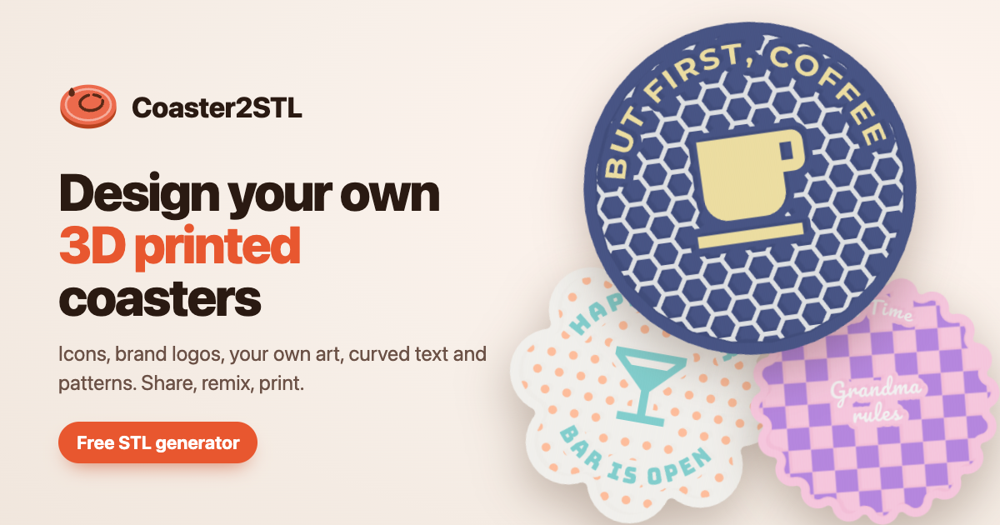

# coaster2stl

Design 3D printable coasters in the browser and share them with everyone: pick a shape, add an icon, a brand
logo, your own artwork or a drawing, curve some text along the rim, choose a pattern and download the STL.
Live at https://coaster2stl.printer.tools.



- **Shapes:** round, square, hexagon, octagon, flower, scallop and gear, with an optional rim
- **Artwork:** quick picks, a searchable library of ~7,400 Material Design Icons and ~3,500 Simple Icons brand
  logos, or your own SVG / PNG / JPG (images are traced to smooth outlines in the browser)
- **Sketchpad:** freehand drawing with pen, eraser, undo and mirror, radial or kaleidoscope symmetry
- **Text:** curved text along the top and bottom of the rim, center text, eight fonts
- **Patterns:** rings, dots, honeycomb, waves, sunburst, checker, terrazzo; kept clear of artwork and text
- **Printing:** raised, engraved or flush inlay; face-down printing for a smooth top; cork recess or rubber feet
  pockets; separate parts for multi-color printers
- **Community gallery:** publish designs with a rendered thumbnail, search, sort by trending / top / new, like,
  report, remix, share links with proper link previews (`/d/<id>`)
- **Fun:** "Surprise me" for a random coaster, and a mug toggle in the 3D toolbar that puts a typical
  11 oz mug (83 mm across, 96 mm high) on the coaster to check its size

Built from the [printer.tools generator template](https://github.com/flxn/printer-tools-template) and the
[businesscard2stl](https://github.com/flxn/businesscard2stl) core, with Vue 3, Vite, TypeScript, three.js,
Clipper, Hono and SQLite.

## How it works

The frontend is the shared workbench (`src/core`) plus the coaster tool (`src/tool`):

- `src/tool/options.ts`: the settings, defaults and validation of settings from outside (saved, imported, published)
- `src/tool/catalog.ts`: shapes, patterns, filament colors, color themes and the quick-pick icons
- `src/tool/outline.ts`, `patterns.ts`, `drawing.ts`: coaster outlines, pattern shapes, sketchpad symmetry
- `src/tool/generator.ts`: builds the parts in the model worker. Everything is cut in 2D (Clipper) and extruded in
  layers (bottom pockets, core, surface, rim), so live updates stay fast and no 3D CSG is needed.
  Curved text is laid out on a straight baseline and bent onto the circle (`core/geometry/warp.ts`).
- `src/tool/artwork.ts`: SVG parsing and image tracing (threshold, pixel outlines, smoothing, simplification)
- `src/tool/api.ts`, `state.ts`: gallery client, loaded designs, remixes and print counts
- `src/tool/components/`: sidebar pieces, the icon library, sketchpad, gallery and share dialogs

The backend (`server/`) is a small [Hono](https://hono.dev) app on Node's built-in SQLite:

- `server/app.ts`: the JSON API under `/api` (designs, likes, reports, downloads, icon search, moderation)
- `server/db.ts`: schema, migrations (`PRAGMA user_version`) and queries; full-text search with FTS5
- `server/icons.ts`: the in-memory icon and brand library
- `server/pages.ts`: share pages (`/d/<id>`) with the design's title and thumbnail for link previews
- `server/index.ts`: the production server (static site + API + share pages + the moderation page)
- `src/admin/`: the moderation page (`admin.html`, a separate small entry without three.js)

There are no accounts. Publishing returns a secret edit token that the browser keeps to delete the design later;
likes and reports count once per anonymous browser id (hashed with `VOTER_SALT`). Designs with
`REPORT_THRESHOLD` reports are hidden until a moderator looks at them. Requests are rate limited per IP.

Changes to the shared core compared to businesscard2stl:
- `core/geometry/polygons.ts`: offsets, intersections, freehand strokes (`strokesToShapes`) and areas
- `core/geometry/warp.ts`: bends shapes with a point mapping (text along an arc)
- `core/tool.ts`: tools can add header actions, buttons in the 3D view toolbar and a section below the workbench
- `core/components/PreviewViewport.vue`: on phones the toolbar spans the full width and the view cube sits below it
- `core/composables/useWorkbench.ts`: `replaceOptions`, a handle to the 3D preview (render images, preview-only
  props like the mug) and an export event
- `core/preview/PreviewStage.ts`: preview-only props, renders from below and in other image formats
- `core/i18n`: deeper paths (`/d/<id>`, `/de/d/<id>`) keep their URL when the language is applied
- fonts: Righteous, Bungee, Lobster and Pacifico added; Space Grotesk and JetBrains Mono removed

## Development

Requires Node 22.18 or newer (runs the TypeScript server directly).

```sh
npm install
npm run dev        # http://localhost:8080, with the API (database in data/dev.db)
npm test           # geometry, tracing and API tests (Vitest)
npm run lint
npm run build      # type check + production build into dist/
npm start          # production server on http://localhost:3000 (serves dist/)
```

## Deployment (Coolify)

Dockerfile build pack, **port 3000**, and a **persistent volume mounted at `/data`** (the SQLite database).
Environment variables (see `.env.example`):

| Variable | Purpose |
| --- | --- |
| `ADMIN_TOKEN` | enables the moderation page at `/admin` (and `/api/admin/*`); use a long random value, e.g. `openssl rand -base64 32` |
| `VOTER_SALT` | salt for hashing anonymous browser ids |
| `REPORT_THRESHOLD` | reports after which a design is hidden (default 3) |
| `PUBLIC_URL` | absolute site URL for share pages |

### Moderation

Open `https://<your-domain>/admin` and sign in with `ADMIN_TOKEN` (in development: `http://localhost:8080/admin`,
token `dev`). The page lists reported, hidden or all designs with search, sorting and report reasons; you can
dismiss reports, hide, restore and delete designs.

- the page itself holds no data: every request goes to `/api/admin/*`, which checks the token (as hashes, in
  constant time); without `ADMIN_TOKEN` the endpoints answer 404
- 10 wrong tokens lock an IP out for 15 minutes
- the token is kept in the tab's sessionStorage only; `/admin` is `noindex`, cannot be framed and is excluded in
  `robots.txt`
- the same endpoints work with curl, e.g.
  `curl -H "Authorization: Bearer $ADMIN_TOKEN" https://<your-domain>/api/admin/designs?status=reported`

| Endpoint | Purpose |
| --- | --- |
| `GET /api/admin/designs?status=reported\|hidden\|all&q=&sort=new\|reports\|likes&offset=&limit=` | designs with report counts, plus statistics |
| `GET /api/admin/designs/<id>/reports` | report reasons |
| `GET /api/admin/designs/<id>/thumbnail` | thumbnail, also of hidden designs |
| `POST /api/admin/designs/<id>` with `{ "hidden": true\|false, "clearReports": true }` | hide, restore, dismiss reports |
| `DELETE /api/admin/designs/<id>` | delete for good |

Back up `/data/coasters.db` (e.g. `sqlite3 coasters.db ".backup backup.db"`); the database runs in WAL mode.

## Credits

- Icons: [Material Design Icons](https://pictogrammers.com/library/mdi/) (Apache 2.0),
  brand logos: [Simple Icons](https://simpleicons.org) (CC0; the brands are trademarks of their owners),
  UI icons: [Lucide](https://lucide.dev) (ISC)
- Fonts: Inter, Montserrat, Oswald, Playfair Display, Righteous, Bungee, Lobster, Pacifico (SIL Open Font License)

## License

MIT. Designs published in the gallery are shared under CC BY 4.0.
